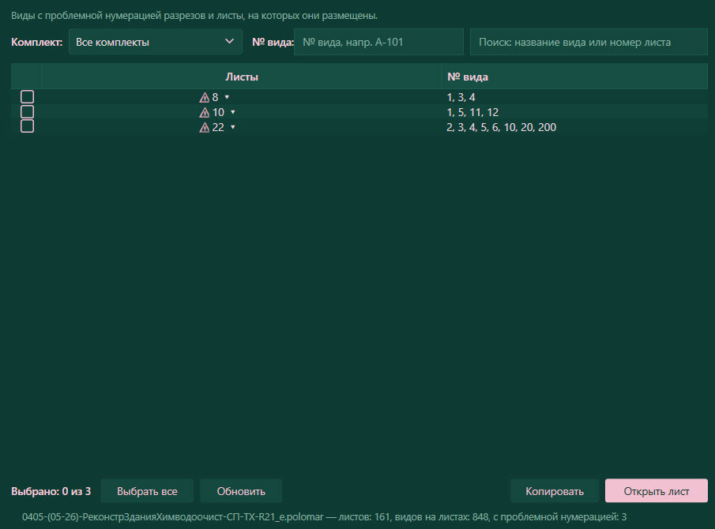

# PallMall — панель «Виды на листах» для Revit

**PallMall v1.3.0** — плагин для Autodesk Revit: таблица проблемных видов на листах с автоконтролем нумерации разрезов и наборы печати по комплектам и форматам.

Окно «Виды на листах»: в таблице — только проблемные листы (`⚠`); у номера каждого листа — стрелка ▾, она раскрывает номера видов, размещённых на этом листе; в колонке «№ вида» — те же номера текстом. Галочками отмечают листы для открытия. Внизу — сводка по модели: сколько листов и видов, сколько с проблемной нумерацией.

Поддерживаемые версии: Revit 2021, 2025.

### Для чего плагин
Чтобы быстро найти проблемные виды на листах, проверить нумерацию разрезов (должна начинаться с 1 и идти по порядку без пропусков, включая парные листы «(начало)» / «(окончание)») и открыть нужный лист или вид в Revit без ручного поиска.

### Кнопки на вкладке «PallMall»
- **Настройки** — версия плагина и проверка обновлений с GitHub (обновление скачивается и применяется после закрытия Revit)
- **Наследовать отметку** — переключатель: держит опцию «Наследовать отметку» на ленте всегда включённой при черчении трубопроводов — сам включает её при выборе инструмента «Труба» и после ESC; состояние сохраняется между сессиями
- **Открыть окно** — открыть/скрыть окно «Виды на листах»
- **Наборы печати** — создать наборы листов для печати и PDF: имя набора — комплект и формат листа, например «АР_А1x3»; открывается отдельное окно с выбором комплекта

### Наборы печати
Наборы создаются по паре «комплект_формат». Комплект берётся с листа (параметр `ADSK_Штамп Раздел проекта`), формат — с основной надписи: параметры «Формат А» (1 = А1) и «Кратность». Кратность 1 не пишется, кратность 2 даёт следующий формат (А3x2 → А2, А2x2 → А1), кратность 3 и больше пишется как есть: А1x3, А3x4.

Создать наборы можно двумя способами: кнопкой **«Наборы печати»** на ленте — окно не блокирует Revit, в нём кнопка «Комплект» с выпадающим списком (пока комплект не выбран, наборов нет); или кнопкой **«Наборы печати»** рядом с фильтром «Комплект» в окне плагина — тогда наборы создаются для выбранного комплекта без окна. Повторный запуск обновляет наборы с теми же именами, а не создаёт копии. Готовые наборы видны в Revit в «Печать → Выбранные листы/виды» и используются при публикации.

Так переключатель выглядит на ленте Revit: слева — выключен, справа — включён («: ВКЛ»):

 

### Кнопки в окне
- **Обновить** — перечитать данные из модели Revit
- **Выбрать все** — отметить все видимые строки
- **Копировать** — скопировать отмеченные строки в буфер обмена (вставятся в Excel)
- **Открыть лист** — открыть отмеченные листы в Revit по очереди
- **Комплект** — фильтр по параметру листа (`ADSK_Штамп Раздел проекта`)
- **Наборы печати** — создать наборы по текущему фильтру «Комплект» (без окна)
- **№ вида** — фильтр по номеру вида
- **Поиск** — поиск по номеру листа, названию листа или номеру вида
- Колонка **«Листы»** — номер проблемного листа; стрелка ▾ раскрывает номера видов листа (клик по виду — открыть его в Revit)

### Установка и обновление
Скачайте `PallMall_Setup_v1.3.0.exe` со страницы [релизов](https://github.com/katyapolomar-dev/PallMall/releases/latest), запустите и перезапустите Revit. Права администратора не нужны.

Обновляться проще из плагина: «Настройки» → «Проверить обновления» → «Скачать и установить» → закрыть Revit — файлы применятся автоматически.

### Сборка установщика (для разработки)
Запустите `release_setup\make_installer.cmd` — он пересоберёт DLL для установленных версий Revit, упакует `PallMall-<год>.zip` и соберёт `PallMall_Setup_v<версия>.exe` через Inno Setup. Версия задаётся в `Version.txt`. Правила работы агентов с репозиторием — в [AGENTS.md](AGENTS.md).
