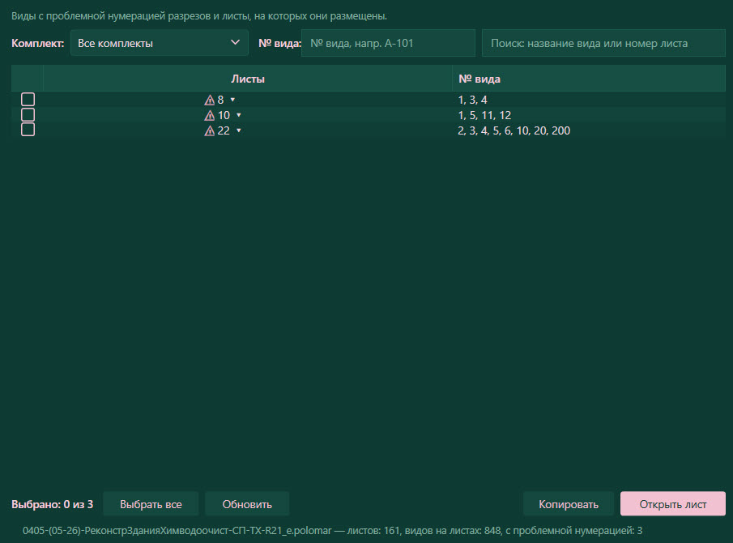

# Sheet Views Map — панель «Виды на листах» для Revit

**Sheet Views Map v1.2.1** — плагин для Autodesk Revit: таблица проблемных видов на листах с автоконтролем нумерации разрезов.

Окно «Виды на листах»: в таблице — только проблемные листы (`⚠`); у номера каждого листа — стрелка ▾, она раскрывает номера видов, размещённых на этом листе; в колонке «№ вида» — те же номера текстом. Галочками отмечают листы для открытия. Внизу — сводка по модели: сколько листов и видов, сколько с проблемной нумерацией.

Поддерживаемые версии: Revit 2021, 2025.

### Для чего плагин
Чтобы быстро найти проблемные виды на листах, проверить нумерацию разрезов (должна начинаться с 1 и идти по порядку без пропусков, включая парные листы «(начало)» / «(окончание)») и открыть нужный лист или вид в Revit без ручного поиска.

### Кнопки на вкладке «Sheet Views Map»
- **Настройки** — версия плагина и проверка обновлений с GitHub (обновление скачивается и применяется после закрытия Revit)
- **Наследовать отметку** — переключатель: держит опцию «Наследовать отметку» на ленте всегда включённой при черчении трубопроводов; состояние сохраняется между сессиями
- **Открыть окно** — открыть/скрыть окно «Виды на листах»

Так переключатель выглядит на ленте Revit: слева — выключен, справа — включён («: ВКЛ»):

 

### Кнопки в окне
- **Обновить** — перечитать данные из модели Revit
- **Выбрать все** — отметить все видимые строки
- **Копировать** — скопировать отмеченные строки в буфер обмена (вставятся в Excel)
- **Открыть лист** — открыть отмеченные листы в Revit по очереди
- **Комплект** — фильтр по параметру листа (`ADSK_Штамп Раздел проекта`)
- **№ вида** — фильтр по номеру вида
- **Поиск** — поиск по номеру листа, названию листа или номеру вида
- Колонка **«Листы»** — номер проблемного листа; стрелка ▾ раскрывает номера видов листа (клик по виду — открыть его в Revit)

### Установка и обновление
Скачайте `SheetViewsMap_Setup_v1.2.1.exe` со страницы [релизов](https://github.com/katyapolomar-dev/SheetViewsMap/releases/latest), запустите и перезапустите Revit. Права администратора не нужны.

Обновляться проще из плагина: «Настройки» → «Проверить обновления» → «Скачать и установить» → закрыть Revit — файлы применятся автоматически.

### Сборка установщика (для разработки)
Запустите `release_setup\make_installer.cmd` — он пересоберёт DLL для установленных версий Revit, упакует `SheetViewsMap-<год>.zip` и соберёт `SheetViewsMap_Setup_v<версия>.exe` через Inno Setup. Версия задаётся в `Version.txt`. Правила работы агентов с репозиторием — в [AGENTS.md](AGENTS.md).
